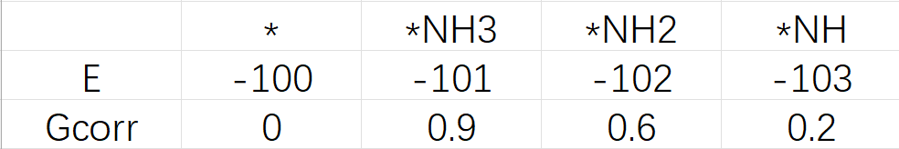
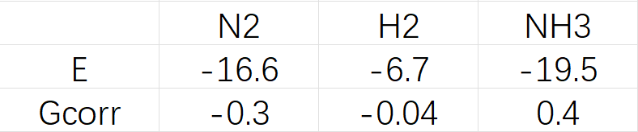

# 台阶图 · Step Plot

反应自由能台阶图编辑器，支持多体系、反应分支、可选过渡态及文字样式调整。

当前版本：[v0.13](./stepplot-v0.13.html)。

[在线使用](https://lin-yueyang.github.io/step_plot/) · [更新记录](./更新.md)

可在线使用，也可下载 HTML，用 Chrome 或 Edge 打开离线使用。

输入 E、Gcorr 与小分子参考项即可绘图。工程通过“保存工程”导出 JSON，下次用“打开”该JSON可继续编辑。

保存图形支持 SVG、PNG、CSV。

## 输入示例

体系的 E、Gcorr 表格（eV）：

小分子的 E、Gcorr 表格（eV）：

在 Excel 等表格软件中复制对应单元格，再粘贴到“体系与状态”或“小分子参考”。

中间态之间原子数量需要守恒，需要手动调整**小分子参考项**和其**系数**。默认以第一个非星号体系作为基准（如*NH3）

